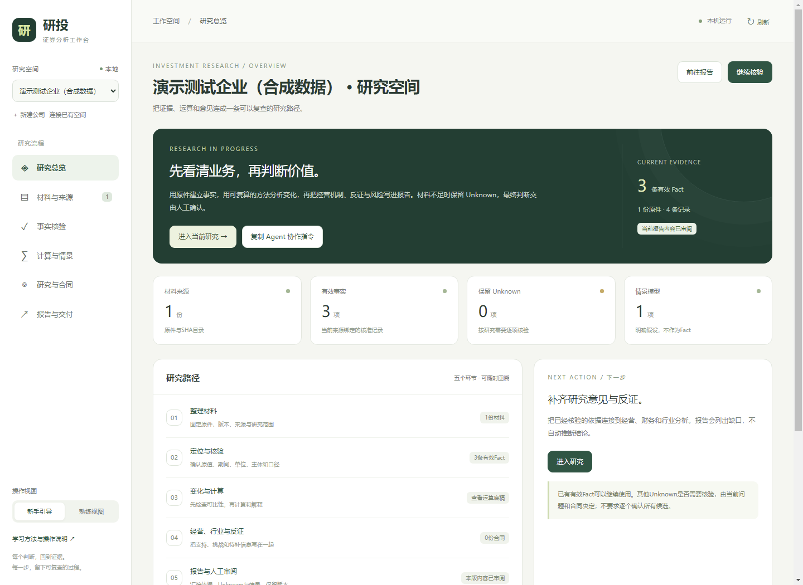
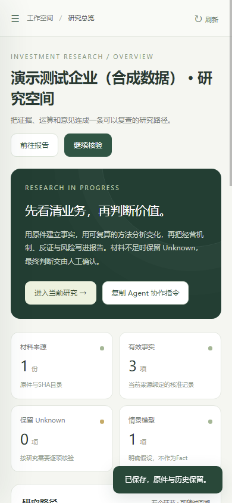

> **2026-10-22：**补充材料3复现学习与材料库整理完成；五包CSV复现一致，三包HTML仅换行差异。新增代理分级/复现skill，历史综合导出归档，新版合同增量待协作；仅成果上传。

> **2026-10-14新增：**方法与补证页面，把财务四环接入价值叙事，显示当前依据/反证/参数/合同增量；新skill可随空白公司项目复用。[操作说明](docs/2026-10-14-两层研究与补证.md)。

# 投资学公司分析通用工作台

2026-10-13 · v2.0。面向初学者到熟练用户的本地证券研究工作台：**材料 → 核验 → 计算与情景 → 研究与合同 → 报告与交付**。新建独立公司项目，也能连接已有工作空间；原件、当前事实、研究意见、假设和真实签署分别保留。



## 开始使用

1. 双击[启动工作台.cmd](启动工作台.cmd)，或运行 `python workbench.py serve`。默认本机运行，无需大模型密钥；核心仅需Python 3.10及标准库。
2. 左侧新建公司，导入原始资料；已有工作空间选择“连接已有空间”。新公司不会继承其他公司Fact、研究判断、授权或签名。
3. 新手视图一次核一项；熟练视图提供表格和检索。登记来源、页码、期间、主体、单位与定义，回原件核对后实际确认。
4. 使用有效输入建立计算候选，填写研究意见、反证和实际合同条款。预测与FCFF情景始终保持Forecast。
5. 生成版本化Markdown、可打印HTML和依据JSON，审阅报告内容后再按实际身份签署。同人执行／复核会注明。

具体步骤见[全流程操作路径](docs/2026-10-13-全流程工作台.md)、[操作指南](docs/操作指南.md)，验证与修正见[本轮验证记录](docs/2026-10-13-验证与修正.md)。

## 当前可以完成什么

| 环节 | 界面功能 | 保存与判断边界 |
| --- | --- | --- |
| 材料 | 文件／目录导入、ZIP归档、用途标注、原件链接 | 原件SHA固定；缓存只定位，导入不代表已经读完 |
| 核验 | 原始披露候选、逐项核验卡、来源与口径、撤回和表格检索 | 当前有效Fact来自真实核准；未核或失效则Unknown |
| 计算 | 同比、毛利率、比率／单价、差额、合计 | 精确十进制、明确输入与换算；跨期七项可比性分别核对 |
| 研究 | 经营、财务、行业、叙事、预测、估值、风险编辑；支持／挑战／替代／反证 | 研究命题保持Interpretation或Forecast，最终判断由人工确认 |
| 合同 | 并行合同、条款执行状态、对应底稿和实际检查说明 | 文件存在、状态勾选、数字核验、内容审阅和签署分开 |
| 情景 | 正FCFF简化折现、逐年输入／现值、净债务和证券股数 | 未填假设不补数；未来结果不是Fact、目标价或买卖决定 |
| 交付 | 不覆盖旧版的MD／HTML／依据快照、内容确认、实际签署收据 | 草稿、来源或假设变化提示重生成；签署绑定真实已审阅版本 |
| 协作 | Agent指令、方法技能、过程底稿、命令行 | 不含自动调用大模型；Agent按实际授权阅读、分析与核准 |

原有ReviewStore工作空间通过独立只读适配接口连接，动态读取原facts()与独立变化/核验域，使用原窗口核验。原actor、时间、原合同版本和旧修正历史保留；不新建重复事实账本。



## 学习与研究方法

[课件学习](skills/investment-company-analysis/references/course-learning.md)、[逐项操作](skills/investment-company-analysis/references/research-operations.md)和[补充方法](skills/investment-company-analysis/references/supplementary-research.md)覆盖披露与口径、年度重大变化、收入／成本／资本／现金四环、行业五步、竞争优势与叙事反证、时间序列单位和冲突、情景及估值。

所有结论标明数字与计算依据；公司披露不自动证明机制，产品均价不代表单品成交价。跨分类、重述及行业双同比保留两条来源和分别计算说明。材料不足时写Unknown及具体补证需求，网络仅作解释／新闻旁证，核心数据以附件为准。

技能入口为[SKILL.md](skills/investment-company-analysis/SKILL.md)。若让Agent继续，复制界面协作指令或直接让其先读项目AGENTS.md与会话交接/CURRENT.md。已有有效数据不反复要求人工核验，来源或输入变化时只重核受影响项目。

## 数据和迁移

通用仓库只发布程序、方法、空模板、验证和标注为合成数据的截图。projects/是新公司目录，runtime/保存本机配置／既有空间连接及原项目报告汇编，均默认不进入工具Git。**通用工具包没有具体公司的Fact、代理授权或签署**。

每个新项目包含程序与方法快照，可复制到另一目录／电脑独立运行。普通项目报告保存在outputs/workbench-reports/，包含不可覆盖的版本及依据；原有手写报告不覆盖。CSV审查只读，单位和时间语义缺失仍Unknown，不信任大数据量或文件名。

Windows启动器自动寻找可用Python；macOS/Linux运行 `sh 启动工作台.sh`。换电脑后重新连接已有空间，连接路径只保留本地。资料格式的文字提取按现有工具能力处理，不宣称自动读完扫描PDF、Word、表格和幻灯片。

```text
python workbench.py doctor
python workbench.py new --company 公司名称 --code 证券代码 --profile general
python workbench.py serve
python -m unittest discover -s tests -v
python scripts/check_bundle.py
```

## 发布与公司研究

本仓库为Investment_yw_finaltask。具体公司成果、合同执行与人工待办在[Investment_yw_10-1_begin](https://github.com/Loyyed/Investment_yw_10-1_begin)；用户指定的补充原件及完整逐行输入保留本地，不随成果上传。GitHub仓库设置中的简介字段与README为两项独立操作，不把README推送冒充设置字段修改。

本轮67项隔离测试、浏览器完整操作及桌面／窄屏检查通过。原核验核心core.py字节保持，保留旧计算指纹。简化FCFF模型适用正FCFF；金融、负FCFF、复杂证券权利和详细分段预测仍需按材料适配，不自动出投资决定。
