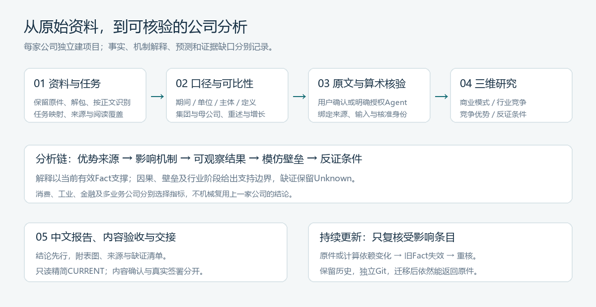

# 投资学公司分析通用工作台

## 当前版本（2026-10-12）

已融合主课件和补充方法：六步研究导航、收入/成本/资本/现金四环节、年度重大变化、行业五步与优势检验、叙事正反证、来源及修正记录。新增只读CSV审查与行业字段字典，45项隔离测试通过。

本仓库发布方法、程序、空模板及验证。公司事实、独立授权和人员签署在各公司项目内维护。工具检查不能确认品牌因果或自动完成合同验收；原值和结论须按当前材料核验。详见[补充方法与验证](docs/2026-10-12-补充方法与验证.md)。

贵州茅台实际研究与按合同待办见[公司成果仓库](https://github.com/Loyyed/Investment_yw_10-1_begin)。本轮补充原件与逐行输入按本人选择保留本地；本工具仓库不顺带上传公司项目。

这是用于下一家公司研究的**方法、技能、模板和本地操作窗口**。初始不包含具体公司数据、已确认Fact、人工签署或投资结论。

工作链为：**资料与要求 → 原文定位 → 结构化提取 → 口径裁决 → 可比性与变化 → 商业模式、行业竞争、竞争优势 → 报告、验收与交接**。

## 本轮新增：从学习到逐项研究

工作窗口新增六步研究导航，新公司自动获得[学习路径](templates/学习路径.md)、[年度变化底稿](templates/年度变化.md)与[合同验收映射](templates/合同验收映射.md)。导航区显示文件准备状态、登记进度及失效的Fact依赖，不把文件齐全视为合同验收。

方法参考新增[课件学习](skills/investment-company-analysis/references/course-learning.md)和[逐项操作](skills/investment-company-analysis/references/research-operations.md)。新项目从收入、成本、资本、现金四环节开始，核对每年重大变化，再开展行业与优势检验。已有公司项目保留原账本，按需补导航，不重建人工历史。

## 最快开始

1. **双击[启动工作台.cmd](启动工作台.cmd)**。Windows本机将打开浏览器；macOS/Linux可运行 `sh 启动工作台.sh`，或在任意平台执行 `python workbench.py serve`。
2. **填写公司名称，创建独立项目，添加资料**。证券代码可以后补；年报、合同、课件、表格和ZIP可直接归档，ZIP自动安全解包。大批文件可粘贴原始资料目录路径导入。
3. **点击“复制给Agent的开工指令”并粘贴到聊天**。Agent按技能阅读材料、完成分析、准备核验卡。您查看原文后点“确认原文与口径”，程序维护事实及历史；报告完成后，在同一窗口确认本版结论与Unknown边界。

默认需Python 3.10或更新版本。核心功能只用标准库，已有Anaconda即可，不自动下载插件、安装软件或修改全局环境。工作台在本机127.0.0.1运行；关闭启动窗口或按Ctrl+C停止。窗口负责资料与核验操作，分析由您的Agent执行，不含自动调用大模型的服务或密钥。

### 直接让下一次Agent开始

也可以直接给Agent这一句，替换公司、资料位置和目标：

> 先读取“投资学公司分析通用工作台/AGENTS.md”和其中的skills/investment-company-analysis/SKILL.md。为【公司】创建独立项目，读取【资料目录】中的原件与压缩包，按【任务要求/研究目的】开展详细分析。给我简洁核验入口、中文报告、图片和精简会话交接，在已有授权范围内自主完成。

技能文件：[investment-company-analysis/SKILL.md](skills/investment-company-analysis/SKILL.md)。它已保存在本项目，可直接读取使用；未自动安装到机器的全局技能目录。如果要通过`$investment-company-analysis`发现，可按所用Agent产品的技能安装方式安装该技能文件夹；也可始终通过上面的路径直接调用。



## 您需要操作什么

| 场景 | 您的操作 | 工作台与Agent承担的工作 |
| --- | --- | --- |
| 新公司 | 填名称、添加材料、说明目的 | 建立独立目录，登记来源/版本，按正文识别用途，制定可执行计划 |
| 数值与叙事核验 | 看原文，点击确认；或在聊天中明确确认已展示记录 | 绑定原件、期间、单位、主体、口径与具体候选，维护有效Fact |
| 希望减少人工核准 | 在窗口明确授权本项目Agent核准，也可选择授权内容验收 | 按授权核准原文与算术，核准身份显示Agent，不伪造本人点击 |
| 有疑问或不同意 | 点击保留Unknown/撤回，写原因可选 | 保留原历史，展示证据缺口、影响及下一验证 |
| 来源或计算改了 | 只复核受影响条目 | 原确认自动失效，未变条目继续可用，不要求全表重做 |
| 完成阅读 | 确认本版结论与Unknown，姓名签署最后填写 | 输出报告、矩阵、内容验收和精简交接；逻辑认可不把机制升为Fact |

## 项目结构与用途

```text
投资学公司分析通用工作台/
├─ README.md / AGENTS.md          人与Agent的入口
├─ skills/investment-company-analysis/
│  ├─ SKILL.md                    简洁技能入口，按需加载参考
│  ├─ agents/openai.yaml          技能名称和调用元数据
│  └─ references/                 工作流、证据、三维框架、计算、行业适配与经验
├─ templates/                    计划、口径、机制、报告、验收和交接模板
├─ companybench/ / workbench.py   通用来源与证据程序、本地核验窗口及命令行
├─ docs/                         操作说明、可视化和版本验证
├─ tests/                        隔离的合成数据测试，不是公司分析结果
├─ projects/                     新公司项目的默认位置，默认不进入工具包Git
└─ runtime/                      本机Python路径、缓存与服务临时文件，Git忽略
```

每个新公司项目拥有sources（原件）、tasks（真实合同/通用计划）、work（候选与修正）、evidence（实际核准与历史）、outputs（报告）、docs（用途及验收）、会话交接（当前摘要），并附程序与方法快照。**复制该项目到另一台电脑后仍可独立运行**，无需回读上一家公司聊天或原项目路径。

工具包与公司项目分开建库。此仓库发布方法、程序、模板和验证，不会顺带推送projects里的公司资料。需要发布某家公司时，按用户实际授权给该项目建立自己的Git和远程。

## 核准与方法的关键区别

- Fact表示在明确边界内核准的原披露或算术；“公司这样说”不等于其机制被证明。
- Interpretation表达品牌、行业阶段、商业模式等有边界判断；Unknown列缺少什么、影响什么、怎样补证。
- 产品组收入÷匹配销量可以计算组均价；固定SKU终端价格、消费者销量及品牌净因果是另外的检验。
- 营业成本与实际生产成本、毛利与净利润、集团CFO与酒类CFO、CFO减资本现金支出与完整FCF分别处理。
- 跨报告原值、重述数和报告披露同比可能不一致；保留原版本与冲突，核可比性后再算，不硬拼行业增长序列。
- 前一家公司的独立代理授权、成熟期判断、指标取舍或确认数，不会传给新公司。

完整方法按问题阅读[工作流](skills/investment-company-analysis/references/workflow.md)、[证据与核验](skills/investment-company-analysis/references/evidence-and-review.md)、[三维分析](skills/investment-company-analysis/references/analysis-framework.md)、[行业适配](skills/investment-company-analysis/references/industry-adapters.md)和[经验与失误修正](skills/investment-company-analysis/references/experience-and-failure-modes.md)。

## 迁移、运行与检查

整个文件夹复制或`git clone`即可迁移，不依赖D盘、用户名、固定端口或全局环境。Windows启动器先尝试本机忽略的runtime/python-path.txt，再找Python启动器、PATH及常见Anaconda目录；换电脑后旧路径无效会继续尝试其它入口。Linux/macOS使用Python3。若Python位置特殊，在runtime/python-path.txt写一行可用解释器绝对路径，或从Anaconda Prompt启动。

```bash
python workbench.py doctor
python workbench.py new --company "研究公司名称" --code "证券代码" --profile general
python workbench.py serve
python -m unittest discover -s tests -v
python scripts/check_bundle.py
```

原PDF始终保留。已有pypdf时可运行index生成定位缓存；没有时仍可归档、核验和由Agent借助现有PDF工具阅读。Word、表格、幻灯片按其格式工具处理，导入成功不宣称正文已读完。

操作详解与Agent命令见[操作指南](docs/操作指南.md)；程序数据格式与真实性边界见[证据接口](skills/investment-company-analysis/references/evidence-and-review.md)。发布前验证见[验证记录](docs/验证记录.md)。Git提交信息、项目说明和报告默认使用中文。

## 给下一次会话的最少上下文

只读该公司会话交接/CURRENT.md，再按需进入当前报告、任务及证据接口。CURRENT仅记录当前状态、授权索引、关键冲突、成果位置与下一步；详细底稿保留在文件里，完整日志和临时文件不成为默认阅读内容。这样既能快速接手，也能从结论返回原件。

## 2026-10-12补充：附件时间序列与修正记录

新增行业数据字典和[补充学习方法](skills/investment-company-analysis/references/supplementary-research.md)，覆盖报价层级、时间窗口、供应商/原公告区分，以及公式/口径冲突。新项目自动附work/series-definition.md空字典，第二步导航可直接查看。只读检查示例：

```text
python workbench.py series-audit --source 路径/数据.csv --cutoff 2024-12-31 --output 路径/检查结果.json
```

截止期只按观测日期筛选，不保证当时可获；更新日不是公告日。命令不会确认Fact，拒绝覆盖原CSV或已有结果，冲突/缺元数据不自动修正。核心仅Python标准库。完整验证见[补充方法与验证](docs/2026-10-12-补充方法与验证.md)。

字段时间含义须有说明：rtime没有元数据时不推定更新日或公开日。只读审查新增中性计数included_rows_rtime_after_cutoff；旧updated计数保留兼容，仅做日期比较，不证明更新或历史可获性。
